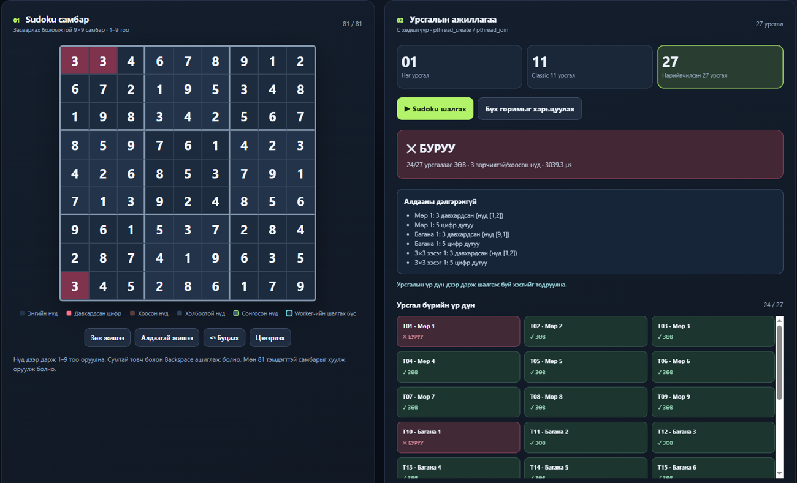
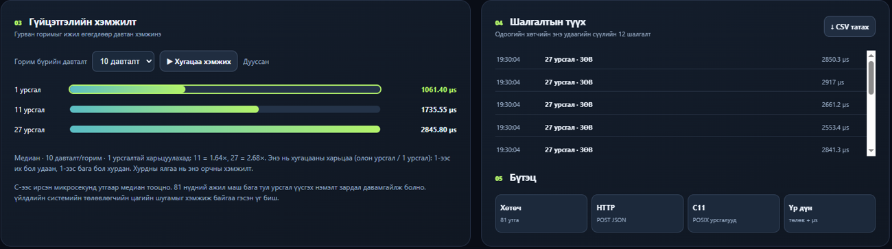

# Sudoku Solution Validator (Pthreads)

9×9 судокугийн шийдэл зөв эсэхийг олон worker thread-ээр зэрэгцээ шалгана.

## Quick Start

[Final release v1.3.3-final](https://github.com/sumya4748-afk/Sudoku-Thread-Validator/releases/tag/v1.3.3-final)

- **MacBook Air M1 / Apple Silicon:** Release-ээс `SudokuValidation_Mac_Ready.zip` татаж задлаад `SudokuValidation.app` нээнэ.
- **Windows:** `SudokuValidation_Windows_Ready.zip`-ийг Extract All хийгээд `SudokuValidation.exe` нээнэ.
- **Эх кодоос (macOS/Linux):** `make`, дараа нь `python3 server.py`. Хөтөч дээр `http://127.0.0.1:8765/dashboard.html` нээнэ.



27 урсгалаас 24 нь зөв, мөр 1, багана 1, дэд тор 1 нь буруу. Windows дээрх бодит туршилт.



Горим тус бүрийн 10 хэмжилтийн медиан 1061.40, 1735.55, 2845.80 мкс. Тайлан, гарын авлага, постер болон ZIP багцуудыг ижил final tag-аас татна.

## Бүтэц

| Файл | Агуулга |
|---|---|
| `sudoku_validator.c` | Үндсэн программ (C11 + Pthreads; build-д ашиглагддаг үндсэн файл) |
| `Makefile` | `make`, `make tsan`, `make asan`, `make test` |
| `run_tests.sh` | Автомат тест (тохиолдлын тоо хувилбар/орчноос хамаарна) |
| `tests/*.txt` | Зөв, буруу, алдаатай оролтын жишээнүүд |
| `ui/sudoku_threads.html` | Интерактив дүрслэл (хөтөч дээр нээнэ) |

## Хөрвүүлэх, ажиллуулах

```sh
make                                   # sudoku_validator үүснэ
./sudoku_validator                     # Figure 4.26-ийн жишээг 11 thread-ээр шалгана
./sudoku_validator -f tests/invalid_one_cell.txt -t 27
./sudoku_validator -g 42 -e 2 -v       # seed 42 судоку, 2 алдаа, thread бүрийн мөрийг хэвлэнэ
cat tests/valid_fig426.txt | ./sudoku_validator -f -
./sudoku_validator -b 2000             # 1 / 11 / 27 горимын хугацааг харьцуулна
```

| Сонголт | Утга |
|---|---|
| `-f ФАЙЛ` | Файлаас унших (`-` = stdin). 81 цифр (эхэнд UTF-8 BOM байж болно); хоосон зай, &#124; - + , үл тооцно; `.` эсвэл `0` = хоосон; `#` = тайлбар |
| `-g SEED` | SEED-ээр санамсаргүй зөв судоку үүсгэх |
| `-e K` | K нүдийг санамсаргүй өөр цифрээр солих |
| `-s R,C,V` | [R,C] нүдийг V болгох (давтаж болно) |
| `-t MODE` | `11` (анхдагч), `27`, `1` |
| `-b REPS` | Хурдны харьцуулалт |
| `-v` / `-q` | Дэлгэрэнгүй / зөвхөн дүн |

Гаралтын код: `0` = зөв, `1` = буруу, `2` = оролтын эсвэл системийн алдаа.

## Thread-ийн стратеги

| `-t` | Worker | Хуваарилалт |
|---|---|---|
| 11 | 11 | 1 бүх мөр, 1 бүх багана, 9 дэд тор (сурах бичгийн санал) |
| 27 | 27 | мөр бүрд 1, багана бүрд 1, дэд тор бүрд 1 |
| 1 | 1 | Бүх 27 бүсийг нэг worker (харьцуулах суурь) |

**Параметр дамжуулах.** Parent `parameters { row, column, count, index }` бүтцийг
`malloc`-оор үүсгэж `pthread_create()`-ийн 4-р аргументаар дамжуулна. `join` хийсний дараа `free` хийнэ.

**Үр дүн буцаах.** Глобал `int valid[MAX_WORKERS]` (`MAX_WORKERS = 27`). i-р worker зөвхөн `valid[i]`-д бичдэг тул
mutex шаардлагагүй; `pthread_join()` нь бичилт parent-д харагдахыг баталгаажуулна.

**Шалгах арга.** Бүс бүрт 10 битийн mask: `v` цифр харагдвал `1<<v` бит асна.
Давхардал = бит аль хэдийн асаалттай. Эцэст нь `mask == 0x3FE` бол 1–9 бүгд байна.

## Тестийн үр дүн

`make test` нь C engine болон sanitizer binary-уудыг хөрвүүлж, автомат тест ажиллуулна. Орчноос хамаарч TSan/ASan ажиллах боломж өөр байж болно.

1. 13 файл/оролтын тохиолдол × 3 горим (зөв, нэг нүд буруу, зөвхөн дэд тор буруу,
   зөвхөн багана буруу, бүрэн бус, бүгд 5, 80 нүд, үсэгтэй, файл байхгүй, stdin, `-s`).
2. 27 горимд `valid[]` массив яг аль бүс буруу болохыг зөв заадаг эсэх.
3. 300 санамсаргүй судоку × 3 горим × (зөв + 1–5 алдаатай).
4. ThreadSanitizer, AddressSanitizer + UBSan: 50 судоку × 3 горим; үр дүнг тухайн CI run-ээс шалгана.
   Хяналтын туршилт: worker бүр `valid[0]`-д бичдэг болгож өөрчлөхөд TSan data race-ийг илрүүлсэн.

## Хурдны хэмжилт

Хугацааны бүх утга микросекундээр. Харьцаа нь тухайн горимын дундаж хугацааг 1 урсгалын дундаж хугацаанд хуваасан утга. «—» тэмдэгтэй үзүүлэлтийг тухайн эх сурвалж горим тус бүрээр мэдээлээгүй.

| Орчин / эх сурвалж | Давталт / горим | Урсгал | Дундаж | Хамгийн бага | Медиан | Хамгийн их | 1 урсгалтай харьцуулсан нь |
|---|---:|---:|---:|---:|---:|---:|---:|
| Анхны тайлан, Linux VM, 2 vCPU, GCC 13.3 | 2000 | 1 | 47.6 | 8.3 | — | — | 1.00× |
| Анхны тайлан, Linux VM, 2 vCPU, GCC 13.3 | 2000 | 11 | 291.7 | 162.3 | — | — | 6.12× |
| Анхны тайлан, Linux VM, 2 vCPU, GCC 13.3 | 2000 | 27 | 672.4 | 415.9 | — | — | 14.12× |
| IV-2-2 шүүмж, WSL2, 12 логик CPU | 2000 | 1 | 248.3 | — | — | — | 1.00× |
| IV-2-2 шүүмж, WSL2, 12 логик CPU | 2000 | 11 | 1024.2 | — | — | — | 4.13× |
| IV-2-2 шүүмж, WSL2, 12 логик CPU | 2000 | 27 | 3235.7 | — | — | — | 13.03× |
| V-1-10 шүүмж, VM | 500 | 1 | 11.13 | — | — | — | 1.00× |
| V-1-10 шүүмж, VM | 500 | 11 | 183.48 | — | — | — | 16.49× |
| V-1-10 шүүмж, VM | 500 | 27 | 477.41 | — | — | — | 42.90× |
| v1.2.1, Linux, 2 логик CPU-д хязгаарласан | 2000 | 1 | 70.51 | 13.43 | 39.78 | 1465.47 | 1.00× |
| v1.2.1, Linux, 2 логик CPU-д хязгаарласан | 2000 | 11 | 492.90 | 220.02 | 398.74 | 5855.72 | 6.99× |
| v1.2.1, Linux, 2 логик CPU-д хязгаарласан | 2000 | 27 | 1301.79 | 604.19 | 1174.79 | 19754.31 | 18.46× |
| v1.2.1, Linux, 4 логик CPU-д хязгаарласан | 2000 | 1 | 86.29 | 32.73 | 38.65 | 3246.72 | 1.00× |
| v1.2.1, Linux, 4 логик CPU-д хязгаарласан | 2000 | 11 | 695.77 | 267.71 | 499.29 | 106074.65 | 8.06× |
| v1.2.1, Linux, 4 логик CPU-д хязгаарласан | 2000 | 27 | 1621.46 | 692.09 | 1284.52 | 27705.17 | 18.79× |

V-1-10 шүүмжид хэмжилтийн хамгийн их хугацаа 1805 мкс хүрснийг дурдсан. Аль горимын утга болохыг заагаагүй.

2026.11.11-ний хэмжилтийг нэг Linux x86-64 орчинд (kernel 6.18.57, GCC 14.2.0, `-O2`) `v1.2.1` эх кодоор, CPU-ийн хязгаарлалтыг 2 болон 4 логик CPU болгон тус тус хийсэн. Давтах команд нь `taskset -c 0,1 ./sudoku_validator -b 2000 -f tests/valid_fig426.txt` бөгөөд 4 CPU-тай хэмжилтэд `0,1,2,3` гэж өгнө. CPU дугаарыг өөрийн орчинд тохируулна. Хамгийн их хугацаа нь тухайн гүйлтийн утга тул системийн ачааллаас хамаарч хэлбэлзэнэ.

## Интерактив дүрслэл

`ui/sudoku_threads.html`-ийг хөтөч дээр нээнэ. Торыг засах, бэлэн жишээ, санамсаргүй
үүсгэх (C-ийн `-g`/`-e`-тэй ижил алгоритм), CPU цөм, `pthread_create` зардал, round-robin квант,
ready queue-ийн дараалал зэрэг параметрээр thread-ийн ажиллагааг симуляц хийж Gantt хуваарь,
`valid[]` массив, pthread лог, туршилтын бүртгэл (CSV), цөмийн тооны графикаар харуулна.

---

## Dashboard болон бэлэн хувилбарууд

Үндсэн интерфэйс нь `dashboard.html`. `server.py` нь локал HTTP bridge бөгөөд C/Pthreads хөдөлгүүрийг ажиллуулж бодит шалгалтын үр дүнг буцаана. `ui/sudoku_threads.html` нь тусдаа сургалтын симуляц.

### Windows — бэлэн EXE

**Windows-д ашиглах тогтмол хувилбар:** [v1.3.3-final Windows ZIP-ийг татах](https://github.com/sumya4748-afk/Sudoku-Thread-Validator/releases/download/v1.3.3-final/SudokuValidation_Windows_Ready.zip). `SudokuValidation_Windows_Ready.zip`-ийг татаж, **Extract All** хийж бүрэн задлаад, доторх `SudokuValidation.exe`-г ажиллуулна. ZIP дотроос нь шууд HTML нээхгүй. Python болон GCC суулгах шаардлагагүй. Windows SmartScreen анхааруулга өгч болзошгүй; зөвхөн итгэлтэй эх сурвалжаас татсан файлыг ажиллуулна.

Эх кодоос Windows дээр ажиллуулахад Python 3 болон MSYS2 UCRT64 GCC шаардлагатай. Төслийн хавтсанд `START_WINDOWS.bat` ажиллуулна.

### macOS — бэлэн APP (Apple Silicon)

[Final release](https://github.com/sumya4748-afk/Sudoku-Thread-Validator/releases/tag/v1.3.3-final)-ээс `SudokuValidation_Mac_Ready.zip` татна. ZIP-үүдийг задлаад `SudokuValidation.app` нээнэ. Apple Developer ID гарын үсэг/notarization байхгүй тул анх удаа **System Settings → Privacy & Security → Open Anyway** зөвшөөрөл шаардаж магадгүй. Intel Mac дээр шалгаагүй.

### macOS / Linux — эх кодоос

Python 3, C compiler, make шаардлагатай. Төслийн хавтсанд:

```sh
make clean && make
python3 server.py
```

Хөтөч дээр `http://127.0.0.1:8765/dashboard.html` нээнэ. Ubuntu/Debian-д эхлээд `sudo apt install build-essential python3` хэрэгтэй байж болно.

### Тест

```sh
python3 -m unittest discover -s tests -v
bash run_tests.sh
```

Windows, macOS, Linux-ийн CI шалгалтыг [GitHub Actions](https://github.com/sumya4748-afk/Sudoku-Thread-Validator/actions) хэсгээс харна. Тестийн тоо, benchmark үр дүн нь орчин, хувилбар бүрээр өөрчлөгдөж болно.

Порт 8765 завгүй бол `python3 server.py --port 8766` гэж асаагаад `http://127.0.0.1:8766/dashboard.html` хаягийг нээнэ.

### Дэлгэрэнгүй заавар

[Хэрэглэгчийн гарын авлага](docs/USER_GUIDE.md). Dashboard-ийн **Алхмаар үзүүлэх** нь C-ээс буцсан үр дүнг тайлбарлан дахин тоглуулдаг; OS thread scheduler-ийн live trace биш. Сервер зөвхөн `127.0.0.1` дээр ажиллана.

## Баримт бичиг

- [Нэг нүүр постер](docs/IV-2-5_Poster.pdf)
- [Эцсийн тайлан](docs/IV-2-5_Final_Report.pdf)
- [PDF гарын авлага](docs/IV-2-5_Manual.pdf)
- [Хэрэглэгчийн гарын авлага](docs/USER_GUIDE.md)

## AI хэрэгслийн ашиглалт

ChatGPT-ийг кодын зарим алдааг засах, нэмэлт тест боловсруулах, баримт бичгийн найруулгыг сайжруулахад ашигласан. Программыг Windows дээр ажиллуулж, зөв, буруу, хоосон самбар болон гүйцэтгэлийн хэмжилтийг багийн гишүүн өөрөө шалгасан.

## Эцсийн туршилтын орчин

C11/Pthreads, Python стандарт сан. Дахин шалгасан Linux орчин GCC 14.2.0, Python 3.12.14, Node.js 24.22.3. Гар туршилтыг Windows дээр хийсэн. C regression 2,170, Python 26 тест давсан. Багц бүрийн BUILD_INFO.txt нь build commit болон суулгасан хувилбаруудыг агуулна. macOS багц Apple Silicon-д зориулагдсан.
